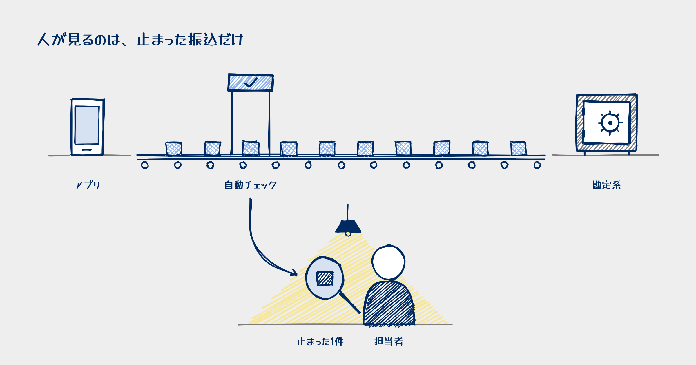
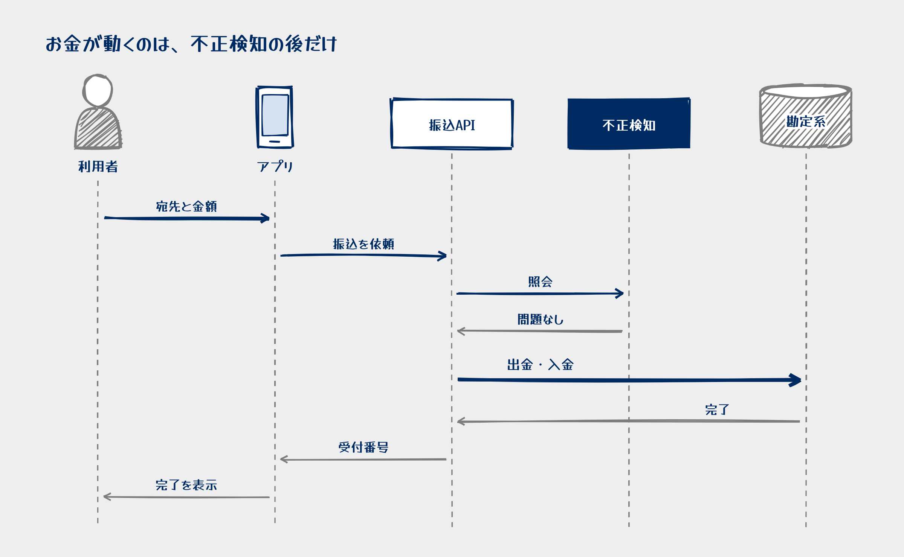
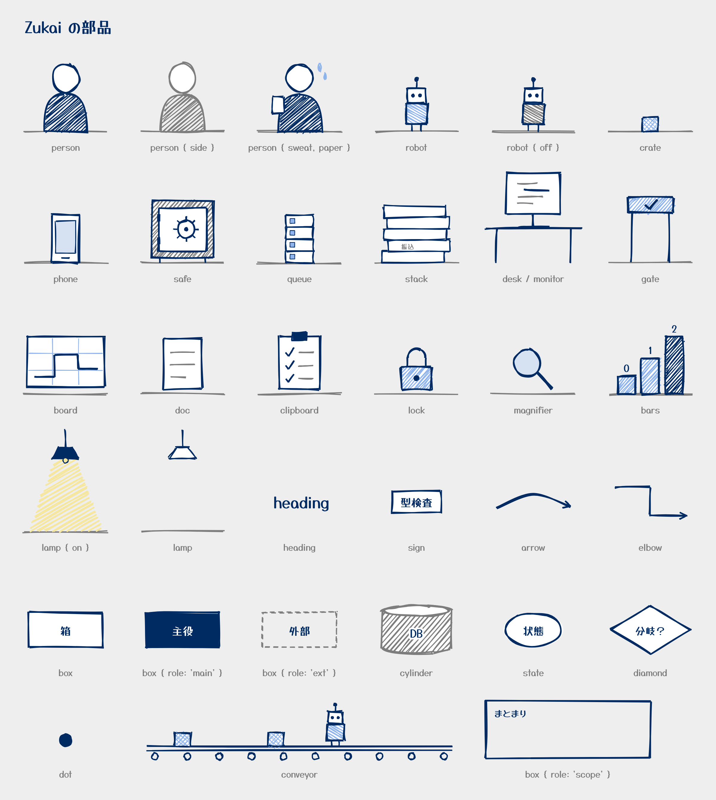
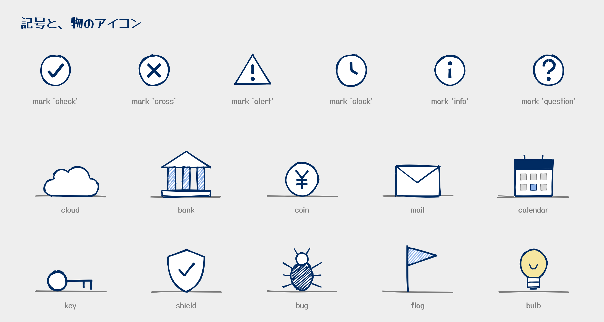

# Zukai

図解を主、文章を従にするためのスキルと、手描き風の図の部品・型の骨組み。



## 中身

| ファイル | 中身 |
|---|---|
| [`SKILL.md`](SKILL.md) | スキルの本体。原則・型の選び方・色と書体の値 |
| [`zukai.js`](zukai.js) | rough.js の上に載せた部品（人・小道具・箱）と、型の骨組み |
| [`examples/`](examples) | 型ごとの見本。見本が仕様。絵のコードは `.js`、`.html` はそれを読み込む枠 |
| [`templates/scene.html`](templates/scene.html) | 図のひな形 |
| [`scripts/render.mjs`](scripts/render.mjs) | HTML の図を PNG に書き出す |

## 見本

題材はすべて、架空のスマホ銀行の「振込」。同じ題材でも、問いが変わると形が変わる。

| 問い | 型 | 見本 |
|---|---|---|
| 何でできているか | 体系図 / ピラミッド / 層 | [nested](examples/nested.png) / [pyramid](examples/pyramid.png) / [layers](examples/layers.png) |
| | ツリー / 構成図 | [tree](examples/tree.png) / [architecture](examples/architecture.png) |
| どうつながるか | コンセプトマップ / 比較図 | [concept](examples/concept.png) / [compare](examples/compare.png) |
| どう進むか | 流れ図 / スイムレーン / シーケンス図 | [flow](examples/flow.png) / [swimlane](examples/swimlane.png) / [sequence](examples/sequence.png) |
| | 状態遷移図 / 循環図 | [state](examples/state.png) / [loop](examples/loop.png) |
| | 工程表 / 年表 | [gantt](examples/gantt.png) / [timeline](examples/timeline.png) |
| どこに位置するか | 4象限 | [quadrant](examples/quadrant.png) |
| 誰がどうなるか | 情景図 | [scene](examples/scene.png) / [before-after](examples/before-after.png) |



## 部品





## 使い方

HTML に読み込み、骨組みの上に中身に合う形を置く。

```html
<link rel="stylesheet" href="https://fonts.googleapis.com/css2?family=Yusei+Magic&display=swap">
<svg id="s" xmlns="http://www.w3.org/2000/svg" width="1200" height="400"></svg>
<script src="https://cdn.jsdelivr.net/npm/roughjs@4.6.6/bundled/rough.js"></script>
<script src="https://cdn.jsdelivr.net/gh/m0rio/Zukai@main/zukai.js"></script>
<script>
const z = Zukai.create(document.getElementById('s'), { width: 1200, height: 400 });
z.heading(60, 56, 'お金が動くのは、不正検知の後だけ');
const x = z.cols(200, 1000, 3);            // 骨組み：列の位置
const s = z.sequence(x, 190, 360);         // 骨組み：時間の線
z.phone(x[0], 180);                        // 中身：合う形を置く
z.box(x[1] - 80, 116, 160, 64, '不正検知', { role: 'main' });
z.cylinder(x[2] - 60, 96, 120, 84, '勘定系');
s.msg(0, 1, 250, '照会');
s.msg(1, 2, 320, '出金・入金', { main: true });
</script>
```

PNG に書き出す。

```sh
npm install
node scripts/render.mjs examples/sequence.html out.png
```

書き出しのときは、CDN の読み込みをこのリポジトリと `node_modules` のファイルに差し替えるので、ネットワークが無くても動く。

## 色と書体

| 役割 | 色 |
|---|---|
| 線・文字・主役 | ネイビー `#002b62` |
| 地 / 白い面 | グレー `#eeeeee` / 白 `#ffffff` |
| 脇役 | グレー `#7d7d7d` |
| 差し色（斜線） | 水色 `#8fb4ec` |
| 明かり（電球など）だけ | 薄い黄色 `#f6e7a0` |

書体は Yusei Magic。値の正本は [`SKILL.md`](SKILL.md) 4章と `zukai.js`。

## 部品や型を足す・直すとき

1. `zukai.js` に関数を足し、`create` の戻り値に加える。型の骨組みは、型の決まりだけを描いて位置を返す。中身までは描かない。
2. 部品は `examples/parts.html` に、型は `examples/<型>.html` に見本を足す。
3. `npm run examples` で全部を書き出し、目で確認する。
4. `SKILL.md` の2章（型）か6章（関数）の表に1行足す。

jsDelivr は `@main` の中身を最大12時間キャッシュする。push した変更がチャット側にすぐ反映されないときがある。

## 参考

- 加藤雄士「体系図を活用した教授法に関する一考察」（知識の構造化＝知識化＋関連付け）
- [diagram-design](https://github.com/cathrynlavery/diagram-design)（MIT、Cathryn Lavery）。型の骨組み、削るテスト、数の上限の考え方を参考にした

## 依存

- [rough.js](https://github.com/rough-stuff/rough) 4.6.6（MIT）
- [Yusei Magic](https://github.com/tanukifont/YuseiMagic)（SIL Open Font License）
