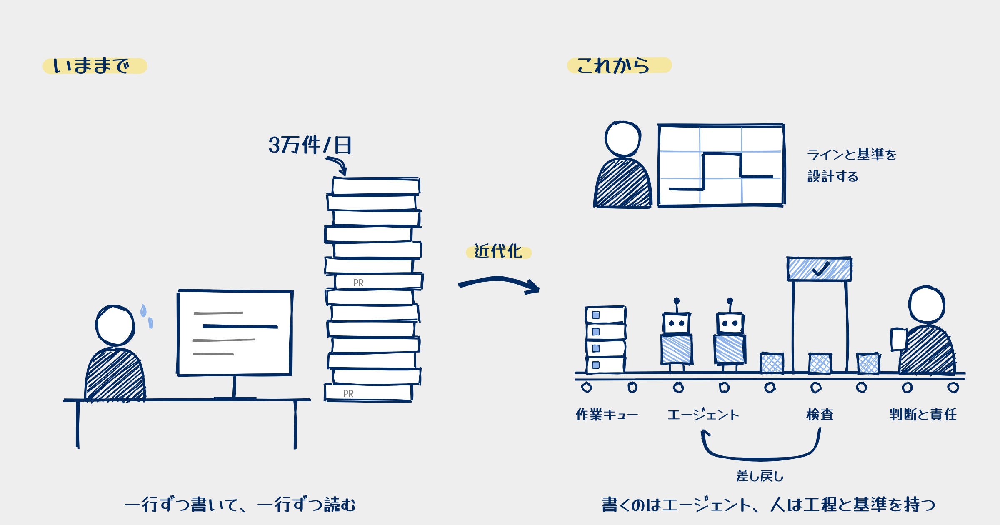

# Zukai

図解を主、文章を従にするためのスキルと、手描き風の図の部品集（Morio Navy）。



## 中身

| ファイル | 中身 |
|---|---|
| [`SKILL.md`](SKILL.md) | スキルの本体。考え方・ルール・色と書体の値 |
| [`zukai.js`](zukai.js) | 部品集。rough.js の上に、人・ロボット・小道具・箱を関数として載せたもの |
| [`templates/scene.html`](templates/scene.html) | 情景図のひな形 |
| [`scripts/render.mjs`](scripts/render.mjs) | HTML の図を PNG に書き出す |
| [`examples/`](examples) | 見本（部品の一覧・情景図・構成図） |

## 部品


## 使い方

HTML に読み込んで、部品を並べる。

```html
<link rel="stylesheet" href="https://fonts.googleapis.com/css2?family=Yusei+Magic&display=swap">
<svg id="s" xmlns="http://www.w3.org/2000/svg" width="1200" height="630"></svg>
<script src="https://cdn.jsdelivr.net/npm/roughjs@4.6.6/bundled/rough.js"></script>
<script src="https://cdn.jsdelivr.net/gh/m0rio/Zukai@main/zukai.js"></script>
<script>
const z = Zukai.create(document.getElementById('s'), { width: 1200, height: 630 });
z.heading(62, 76, 'これから');
z.conveyor(90, 700, 448);
z.robot(230, 448);
z.person(560, 448, { paper: true });
</script>
```

PNG に書き出す。

```sh
npm install
node scripts/render.mjs examples/before-after.html out.png
```

書き出しのときは、CDN の読み込みをこのリポジトリと `node_modules` のファイルに差し替えるので、ネットワークが無くても動く。

## 色と書体

| 役割 | 色 |
|---|---|
| 線・文字・主役 | ネイビー `#002b62` |
| 地 / 白い面 | グレー `#eeeeee` / 白 `#ffffff` |
| 脇役 | グレー `#7d7d7d` |
| 差し色（斜線） | 水色 `#8fb4ec` |
| 見出しのマーカー | 薄い黄色 `#f6e7a0` |

書体は Yusei Magic。

## 部品を足す・直すとき

1. `zukai.js` に関数を足し、`create` の戻り値に加える。
2. `examples/parts.html` に見本を足す。
3. `npm run examples` で3枚を書き出し、目で確認する。
4. `SKILL.md` 10章の部品の表に1行足す。

jsDelivr は `@main` の中身を最大12時間キャッシュする。push した変更がチャット側にすぐ反映されないときがある。

## 依存

- [rough.js](https://github.com/rough-stuff/rough) 4.6.6（MIT）
- [Yusei Magic](https://github.com/tanukifont/YuseiMagic)（SIL Open Font License）
